# Kopi dan Nyemil

Aplikasi Android pemesanan kopi, minuman, dan makanan ringan.
Tagline: **Teman Ngopi, Teman Ngemil**.

## Deskripsi
Kopi dan Nyemil adalah aplikasi Android untuk memesan kopi, minuman, dan camilan
dengan cara yang simpel. Pengguna bisa melihat menu, mencari minuman atau makanan
favorit, memasukkannya ke keranjang, lalu menentukan alamat pengiriman dan metode
pembayaran. Setelah pesanan dibuat, rincian dan statusnya langsung tampil, dan
riwayat pesanan bisa dilihat kapan saja.

Desainnya dibuat minimalis dengan warna navy, teal, dan beige yang hangat, supaya
nyaman dipakai dan tetap terasa seperti suasana kedai kopi.

Aplikasi ini masih berupa **versi demo**. Proses login dan pembayaran (Transfer Bank,
E-Wallet, dan QRIS) hanya simulasi, dan seluruh data tersimpan di perangkat tanpa
server, jadi belum ada transaksi sungguhan yang diproses.

Tampilan aplikasi mengikuti wireframe yang diberikan dosen, lalu dikembangkan agar lebih
modern dengan tambahan Keranjang, pilihan metode pembayaran, dan riwayat pesanan.

## Fitur
- Welcome, Sign Up, Lengkapi Data (Register), dan Login dengan validasi input
- Home: daftar 8 produk, pencarian, dan filter kategori (Semua, Kopi, Non-Kopi, Snack)
- Keranjang: tambah, kurangi, dan hapus produk, dengan subtotal, ongkos kirim, dan total
- Alamat pengiriman: tambah, ubah, hapus, dan pilih alamat utama
- Metode pembayaran: Transfer Bank, E-Wallet, dan QRIS (simulasi)
- Konfirmasi pesanan dengan nomor pesanan unik dan instruksi pembayaran sesuai metode
- Riwayat pesanan tersimpan di perangkat
- Profil: ubah data pribadi, ganti foto profil, dan bantuan via WhatsApp

## Teknologi
- **Bahasa:** Kotlin
- **Tampilan:** XML Layout (LinearLayout, ScrollView, GridLayout) dan vector drawable
- **Komponen:** AndroidX AppCompat, AlertDialog, dan Activity Result API (memilih foto dari galeri)
- **Navigasi:** Intent antar Activity (9 halaman utama dan Riwayat Pesanan)
- **Penyimpanan lokal:** SharedPreferences dengan data format JSON (akun, alamat, dan pesanan)
- **Keamanan:** password di-hash dengan SHA-256 dan salt, bukan disimpan sebagai teks biasa
- **Build:** Gradle Kotlin DSL
- **Package:** `lat.pam.kopidannyemil`

## Cara Menjalankan Aplikasi
1. Pasang aplikasi di HP atau emulator Android (build dari project ini di Android Studio).
2. Buka aplikasi **Kopi dan Nyemil**, lalu ketuk **Masuk**.
3. Buat akun lewat **Sign Up**, lengkapi data di **Lengkapi Data**, centang Syarat & Ketentuan, lalu ketuk **Buat Akun**.
4. Di **Home**, cari menu atau pilih kategori, lalu ketuk tombol **+** untuk menambah ke keranjang.
5. Buka **Keranjang** (ikon keranjang di kanan atas), atur jumlah produk, lalu isi alamat pengiriman.
6. Pilih metode pembayaran (**Transfer Bank**, **E-Wallet**, atau **QRIS**), lalu ketuk **Lanjut Pembayaran**.
7. Lihat instruksi pembayaran di halaman konfirmasi. Riwayat pesanan ada di menu **Pesanan** atau **Profil → Riwayat Pesanan**.

## Catatan
- Login memakai akun yang disimpan di perangkat (password disimpan dalam bentuk hash).
- Pembayaran dan QRIS hanya simulasi dan tidak memproses transaksi nyata.
- Pembayaran sungguhan membutuhkan backend dan penyedia pembayaran.

## Screenshot

### Autentikasi
<table>
  <tr>
    <td align="center"><b>Welcome</b> 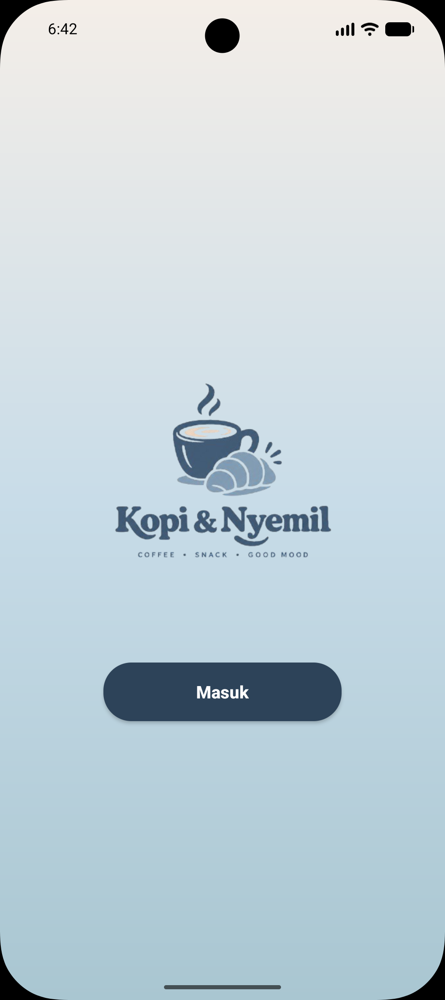</td>
    <td align="center"><b>Sign Up</b> 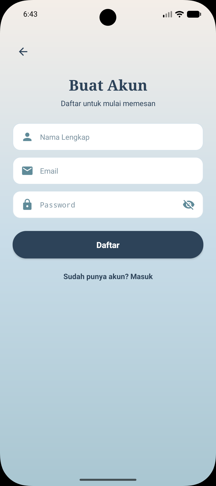</td>
    <td align="center"><b>Lengkapi Data</b> 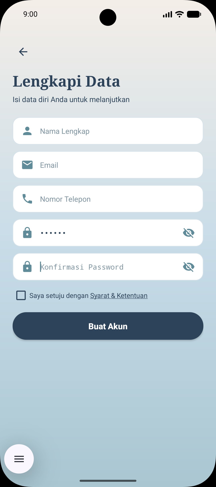</td>
    <td align="center"><b>Login</b> 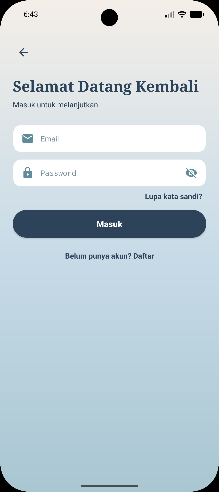</td>
  </tr>
</table>

### Menu dan Keranjang
<table>
  <tr>
    <td align="center"><b>Home</b> 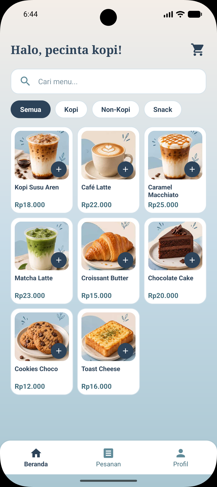</td>
    <td align="center"><b>Filter</b> 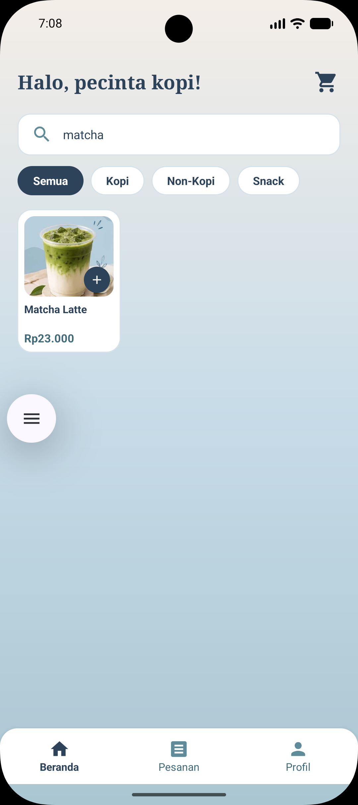</td>
    <td align="center"><b>Keranjang</b> 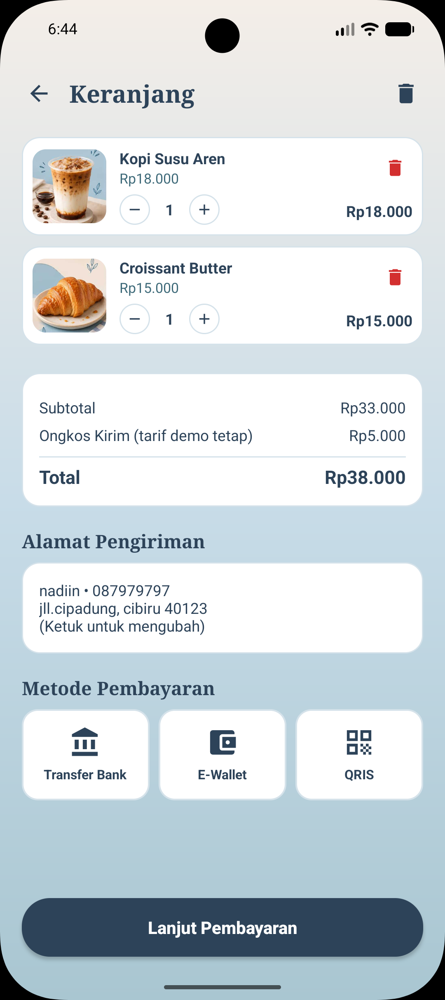</td>
    <td align="center"><b>Alamat</b> 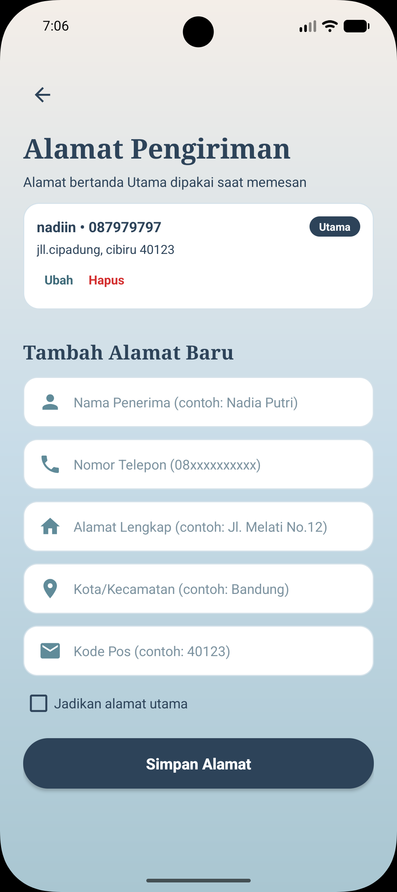</td>
  </tr>
</table>

### Konfirmasi Pesanan
<table>
  <tr>
    <td align="center"><b>Transfer Bank</b> 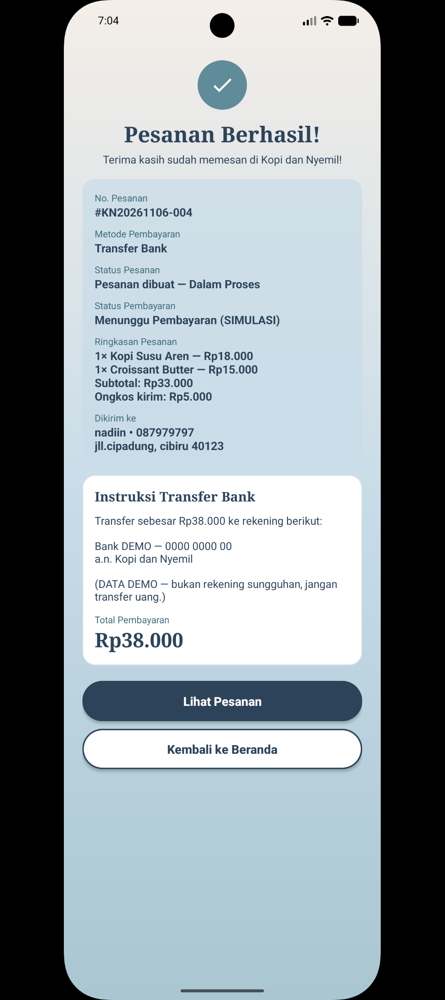</td>
    <td align="center"><b>E-Wallet</b> 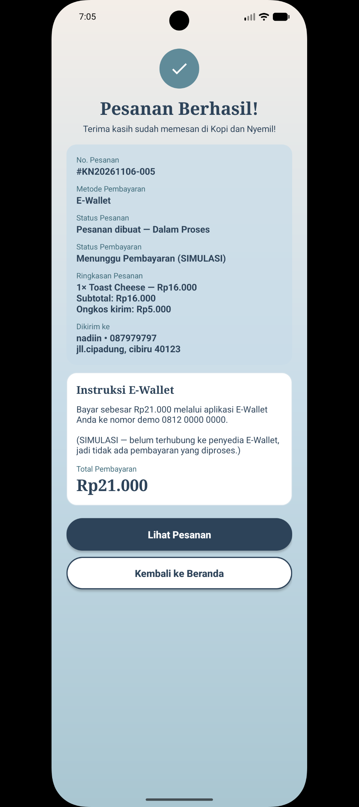</td>
    <td align="center"><b>QRIS</b> 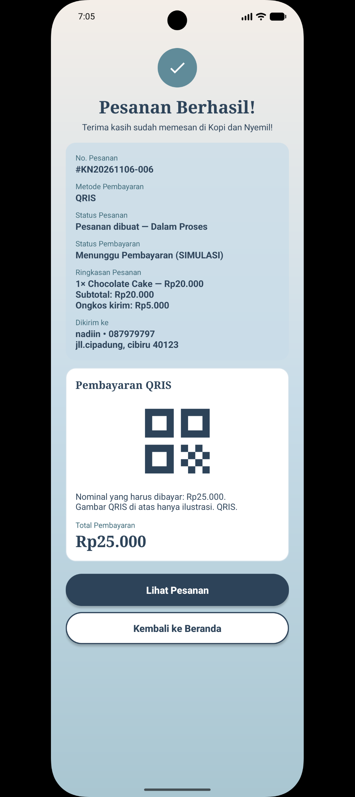</td>
    <td align="center"><b>Riwayat Pesanan</b> 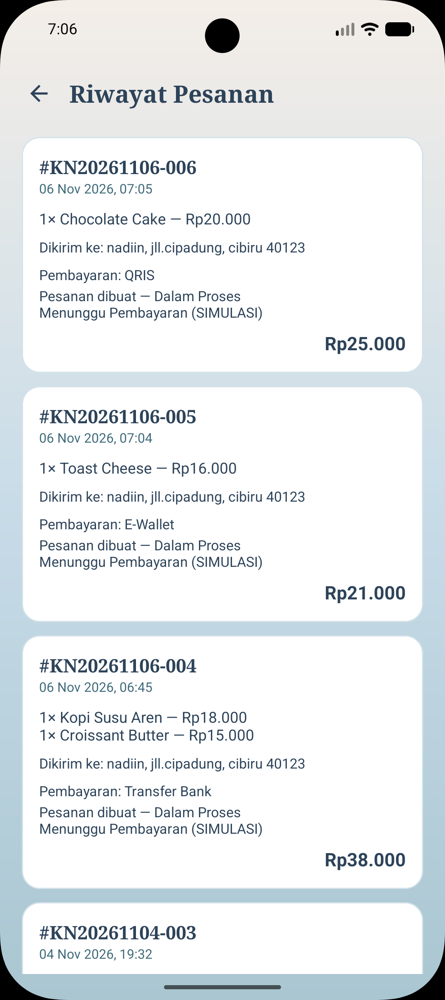</td>
  </tr>
</table>

### Profil
<table>
  <tr>
    <td align="center"><b>Profil</b> 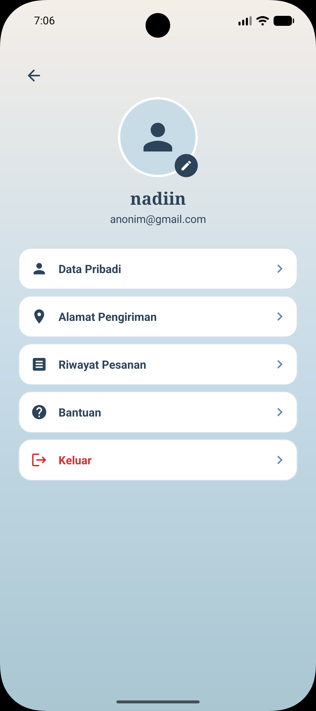</td>
    <td align="center"><b>Ubah Data</b> 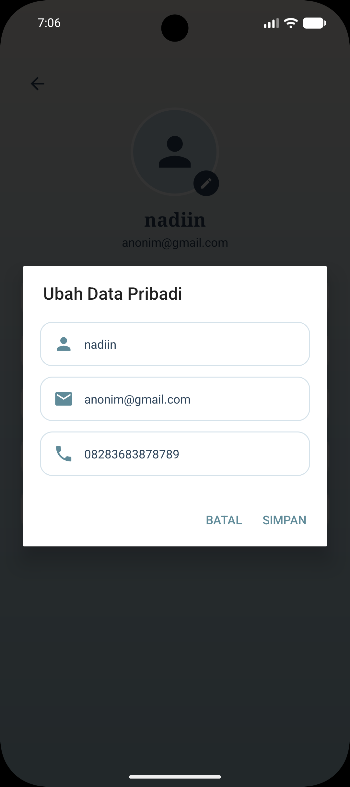</td>
    <td align="center"><b>Bantuan</b> 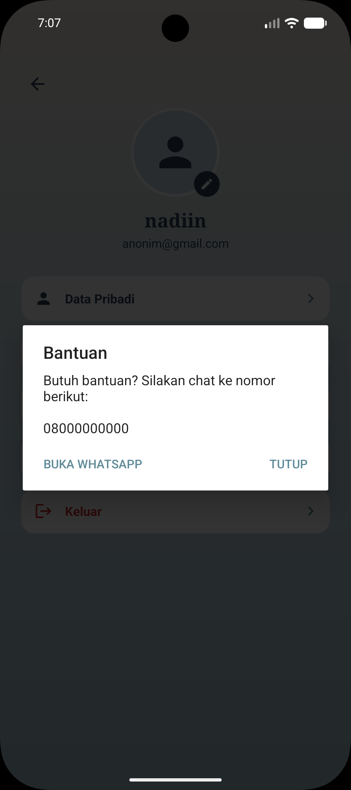</td>
  </tr>
</table>

## Pembuat
- Nama: Nadiin Nur'Azizah W
- NIM: 1247050128
- Mata kuliah: Pengembangan Aplikasi Web
